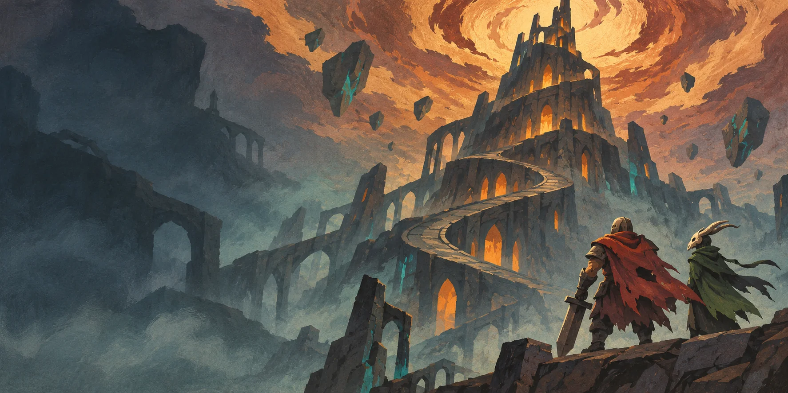

# The Spire Within · 尖塔人格档案

**高塔之中，你是谁？**

一款以《Slay the Spire / 杀戮尖塔》一代为背景的 MBTI 风格同人人格测试。沿着随机地图向上攀登，在商店、营火、战斗和日常片刻中作出选择，遇见与你相似的尖塔角色。

An MBTI-inspired Slay the Spire fan quiz. Climb a changing map, make 30 or 50 choices, and discover your Spire character. Available in Simplified Chinese, English, French and Korean.

[](https://spire-personality-uomocapra.aerialmonkey1.chatgpt.site/)

<p align="center">
  <a href="https://spire-personality-uomocapra.aerialmonkey1.chatgpt.site/?lang=zh">简体中文</a> ·
  <a href="https://spire-personality-uomocapra.aerialmonkey1.chatgpt.site/?lang=en">English</a> ·
  <a href="https://spire-personality-uomocapra.aerialmonkey1.chatgpt.site/?lang=fr">Français</a> ·
  <a href="https://spire-personality-uomocapra.aerialmonkey1.chatgpt.site/?lang=ko">한국어</a>
</p>

## 在尖塔里认识自己

- **30 题或 50 题**。标准版约需 6–9 分钟，完整版约需 10–15 分钟。情境题与日常题交错，用五档选择表达自己更接近 A 还是 B。
- **会变化的登塔地图**。每段新旅程生成主线和三条岔路，最多四条路线并行，分叉、汇合，岔路在塔顶前以墨叉收尾。可以回访已答节点、预览岔路。
- **到达、落墨、翻牌**。节点墨圈之后显示地点插画，再翻开题卡。商人的摊布支持下拉，动画遵循系统的减少动态效果设置。
- **16 份角色档案**。铁甲战士、静默猎手、观者、故障机器人，以及首领和事件人物，各有故事依据、同人解读和短暂的招牌动作。
- **24 幅 AI 背景**。首页、房间、摊布、羊皮纸和牌背采用统一画风；三哨卫和甜圈、八体另有手机竖幅。
- **四种语言随时切换**。中文、英语、法语、韩语覆盖题目、地图提示、角色档案和身份卡。切换时保留答案、楼层与商人摊布状态。
- **留下自己的档案**。浏览器自动保存进度，支持续答、回看、PNG 身份卡下载和角色链接分享。

## 本地运行

需要 Node.js 20.11 或更新版本。网站使用原生 HTML、CSS 和 JavaScript ES modules，运行和单元测试均无需安装依赖。

```bash
git clone https://github.com/Uomocapra/the-spire-within.git
cd the-spire-within
npm start
```

在浏览器打开 <http://127.0.0.1:4178>。请通过 HTTP 访问，浏览器直接打开本地 HTML 文件时会限制 ES modules。

```bash
npm test
```

测试覆盖题库结构、正反向计分、16 种结果可达性、持平结果、地图路线、动画生命周期及四语内容完整性。

### English quick start

Use Node.js 20.11+. Clone the repository, run `npm start`, then open <http://127.0.0.1:4178/?lang=en>. No dependency installation or build step is needed. Run `npm test` for the unit tests. To host your own copy, serve the contents of `dist/` with a static web server.

## 题目与结果

采用 E/I、S/N、T/F、J/P 四组倾向。50 题包含标准版的全部 30 题，再增加 20 题。每题同等权重，各维度按题数归一化。每题附有编写理由，译本通过相同题目 ID 对应原版选项与计分。

| 地图标记 | 对应内容 |
| --- | --- |
| 怪物 | 与游戏相关的情境问题 |
| 问号 | 与游戏无关的日常问题 |
| 精英 | 需要多想一会儿的问题 |
| 营火 | 休息、整理与恢复节奏 |
| 商店 | 资源与选择的取舍 |

恰好持平的维度显示为 **X**，页面列出相容角色。当四个维度均有方向时，才揭晓唯一角色。百分比表示本次回答的相对倾向，靠近中点时可同时参考两侧描述。

这是未经心理测量验证的同人趣味测试，供自我观察和交流使用。角色对应来自游戏故事、事件或战斗机制的同人解读。本项目与官方 MBTI® 量表及 Mega Crit 均无隶属关系，相关商标归各自权利人。

## 项目结构

```text
dist/
  index.html                 页面入口
  app.js                     导航、答题、结果与身份卡导出
  questions.js               50 道中文题目与编写理由
  scoring.js                 四维计分和会话校验
  characters.js              16 份中文角色档案与资料链接
  i18n.js                    语言加载与偏好保存
  locales/                   英、法、韩内容包和四语界面文案
  journey-map.js             地图生成、移动与到达墨圈
  room-scenes.js             地点选择、预加载与商人摊布
  quiz-reveal.js             题卡翻开动画
  motions.js                 角色动作与特效
  assets/ai-scenes/          24 幅 AI 插画及完整提示词
  assets/characters/         角色素材与来源记录
  assets/map/                地图图标与来源记录
  scene-credits.html         插画图集
scripts/
  serve.mjs                  本地静态服务器
  *-qa.mjs                   浏览器流程检查
tests/                       Node.js 单元测试
docs/                        题目审阅、角色依据与设计记录
```

### 修改内容

- 改题时，同时检查 `questions.js` 中的 `axis`、`direction` 与选项含义，再更新三种译本。题库版本决定已保存的答案能否继续使用。
- 添加界面文字时，在 `locales/interface.js` 补齐四种语言。`?lang=zh`、`?lang=en`、`?lang=fr` 和 `?lang=ko` 可直接指定语言。
- 修改人物时，保留 `lore` 的游戏依据、`reading` 的同人解读及来源链接。
- 替换场景时，同步检查手机焦点、内嵌预览和预加载。生成提示词记录了这组背景的创作方向。

### 浏览器检查

`scripts/*-qa.mjs` 使用 Playwright 连接已经运行的 Chrome，默认 CDP 地址为 `http://127.0.0.1:6112`。在本地服务器运行后，可安装可选测试工具并执行流程检查。

```bash
npm install --no-save --package-lock=false playwright
node scripts/language-browser-qa.mjs
```

公开仓库中的脚本支持通过 `CDP_URL` 指定浏览器地址，通过 `PLAYWRIGHT_MODULE` 指定已有模块。任务创建后台标签页，完成后关闭。部分旧检查会改写测试来源下的浏览器存储，请使用专用测试环境。

## 静态部署

将 `dist/` 的内容作为网站根目录上传到静态托管服务即可，无需服务端或构建命令。HTML、JavaScript、CSS、图片和语言包需一起上传并保留目录结构。

制作副本时，可将 `dist/index.html` 中的分享图片绝对地址改成自己的域名。在线演示由 Sites 托管，GitHub 仓库与演示站部署分别维护。

## 隐私

答案仅保存在当前浏览器的 localStorage，清除站点数据会移除进度。分享链接只包含语言和角色类型。译文预先随站点提供，切换语言直接载入对应文件。页面会从 Google Fonts 请求字体，资料链接则指向外部来源。

## 素材与权利

《Slay the Spire》的角色形象、游戏设定及原作素材归 Mega Crit 和相应权利人所有。角色动画由静态原画配合本站编写的动作和特效组成，下载的身份卡为静态 PNG。

首页与地点背景由 ImageGen 生成。仓库保留素材来源和完整生成提示词，便于逐项查阅。

- [角色故事与图片来源](docs/lore-sources.md)
- [角色素材来源记录](dist/assets/characters/provenance.json)
- [地图图标来源记录](dist/assets/map/provenance.json)
- [AI 插画生成提示词](dist/assets/ai-scenes/prompts.json)
- [在线插画图集](https://spire-personality-uomocapra.aerialmonkey1.chatgpt.site/scene-credits.html)

本仓库尚未授予统一开源许可证。公开可见不代表获得角色、美术或代码的任意使用授权，使用或再发布前请分别核对相应权利与许可。
